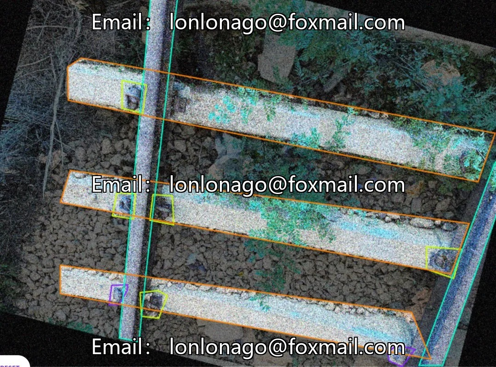
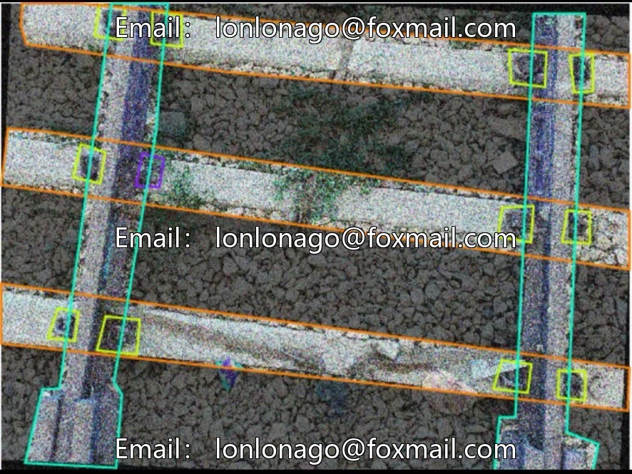
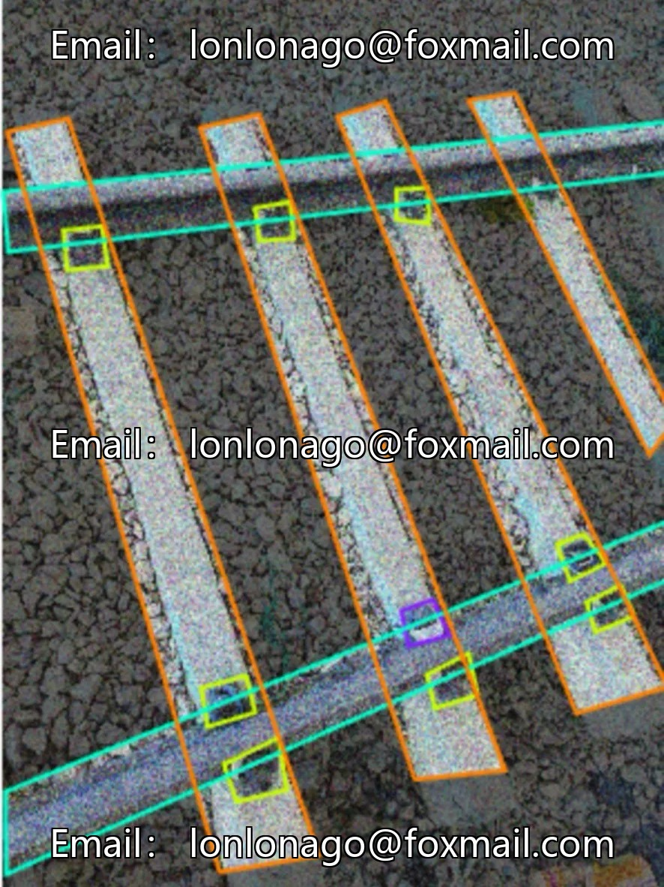
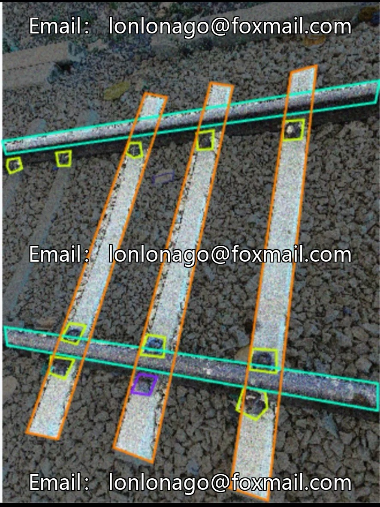

# Intelligent Railway Scenario Identification Dataset, Railway Fastener Identification Dataset, Railway Obstacle Identification

## Body

Intelligent Railway Scenario Identification Dataset, Rail Fastener Identification Dataset, Rail Obstacles Identification, Track Pile Identification, and Track Defect Identification Dataset. DETR Yolo Issue #10029

Target detection dataset, 5 core categories: fasteners (fastener), missing fasteners (missingfastener), obstacles (obstacle), railway track (railwaytrack), sleepers (sleeper), total 393 labeled images, 3 groups, suitable for training of small and medium-sized target detection models, supports mainstream formats such as YOLO, detr.

The dataset focuses on railway scenarios, covering key components such as rails, sleepers, fasteners, etc., supporting the research and development of intelligent detection technology to enhance the automation capability of railway operations and maintenance.

Virtual materials, once sold, are non-refundable.
Interested friends, click "I want" to proceed.

## Images

## Payment

Here is a pay link on Stripe ( https://buy.stripe.com/3cs8yP7sY87d0vu9AB ). Please contact me lonlonago@foxmail.com after funding $89, and I will send you a complete data files , thank you!

